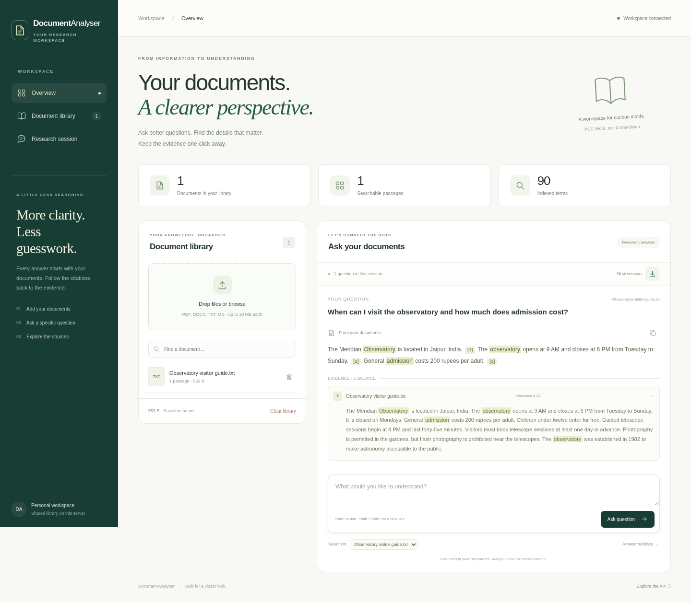

# DocumentAnalyser

### Your documents. A clearer perspective.

[](https://github.com/arpitkjaiswal/DocumentAnalyser/actions/workflows/checks.yml)

A document research workspace that turns PDFs, Word files, and notes into **answers you can trace back to the evidence**. Search locally without an API key, explore the cited passages, and export a research session when you are done.

**FastAPI · SQLite · scikit-learn · Vanilla JavaScript**

Maintained by [Arpit Jaiswal](https://github.com/arpitkjaiswal).

[Quick start](#run-it) · [Render deployment](#deploy-on-render) · [Engineering notes](docs/architecture.md) · [Demo walkthrough](docs/demo.md)



## A useful research loop

1. **Build a library.** Upload PDF, DOCX, TXT, or Markdown files. Search by filename, replace an existing document, or remove it.
2. **Ask a specific question.** Search the whole library or focus on one document. Get an extractive answer without an external service.
3. **Follow the evidence.** Click a citation to open its source passage. PDF sources include page numbers. Scores show retrieval relevance, not confidence.
4. **Keep your findings.** Copy an answer or export the current session, including source passages, as Markdown.

The responsive workspace includes a sample document, keyboard submission, accessible form labels, loading states, upload validation, and confirmation before destructive actions. Questions in a session are independent; this is not conversational memory.

## Run it

Use **Python 3.12**. Clone the repository, then run:

```bash
git clone https://github.com/arpitkjaiswal/DocumentAnalyser.git
cd DocumentAnalyser
python3 -m venv .venv
source .venv/bin/activate
python -m pip install -r requirements.txt
python -m uvicorn backend.main:app --host 127.0.0.1 --port 8000 --reload
```

On Windows, activate with `.venv\Scripts\activate` instead.

Open `http://127.0.0.1:8000`, choose **Try a sample document**, and ask the suggested question. API documentation is at `/docs`.

No API key, database service, GPU, or model download is needed for extractive answers. Scanned PDFs need OCR before upload; OCR is not included.

## What makes the implementation interesting

- **Restart recovery:** SQLite retains extracted text and metadata; the sparse index is rebuilt on startup.
- **Atomic replacement:** candidate documents are validated before a transaction replaces existing content. A failed upload preserves the old version.
- **Grounded retrieval:** zero-similarity passages are excluded, document scope is enforced, and unmatched queries return no sources.
- **Graceful provider fallback:** optional generated answers require valid citation numbers; provider errors fall back to extraction without returning raw provider errors.
- **Verified workflows:** regression tests, a real-browser smoke test, a small retrieval evaluation, and a GitHub Actions workflow are included.

Use the [three-minute demo guide](docs/demo.md) to walk through the working app. Read the [engineering notes](docs/architecture.md) for the consistency model, tradeoffs, and known limitations.

## Test and evaluate

```bash
python -m pip install -r requirements-dev.txt
python -m unittest discover -s tests -v
python -m evaluation.run
ruff check backend tests evaluation
ruff format --check backend tests evaluation
node --check static/app.js
```

Tests use temporary or in-memory databases. They do not reset your library or require live AI credentials. Provider requests are mocked in automated tests.

The evaluation prints per-query results, Hit@1, MRR@3, and zero-overlap abstention. Its fixture contains **4 synthetic documents, 12 answerable queries, and 3 zero-overlap queries**. These are smoke checks for lexical retrieval, not evidence of general question-answering accuracy. Add representative documents and harder paraphrases before drawing broader conclusions.

Optional browser check:

```bash
python -m pip install playwright==1.62.0
python -m playwright install chromium
python tests/browser_smoke.py
# Or use a system browser:
python tests/browser_smoke.py --browser /usr/bin/chromium
```

The browser script creates its own server and temporary database. Pass `--screenshots /tmp/documentanalyser-shots` to capture the desktop and mobile views. Node is only needed for the JavaScript syntax check; the frontend has no package installation or build step.

## Deploy on Render

Push your version to GitHub, create a Render **Blueprint**, select the repository, and review [`render.yaml`](render.yaml). The Blueprint does not configure a paid persistent disk.

| Setting      | Value                                                                        |
| ------------ | ---------------------------------------------------------------------------- |
| Runtime      | Python 3.12.14                                                               |
| Build        | `pip install -r requirements.txt`                                            |
| Start        | `python -m uvicorn backend.main:app --host 0.0.0.0 --port $PORT --workers 1` |
| Health check | `/api/health`                                                                |

Use **one worker and one instance**: the search cache is local to the process. For an ephemeral demo, the default SQLite location works, but files can disappear when Render replaces the instance or redeploys it. For durable storage, attach a persistent disk in Render and set `DOCUMENT_DB_PATH` to a file on its mount, for example `/var/data/documents.sqlite3`. Check Render's current disk and plan requirements before enabling one.

The library survives an ordinary local process restart as long as its SQLite file remains. Browser session history lasts only until reload; export it when needed.

## Configuration

Copy `.env.example` to `.env` for local settings, or use your host's environment settings. Never commit credentials.

| Variable           | Purpose                             | Default                                            |
| ------------------ | ----------------------------------- | -------------------------------------------------- |
| `DOCUMENT_DB_PATH` | SQLite file location                | `data/documents.sqlite3` in the repository         |
| `OPENAI_API_KEY`   | Enable OpenAI-compatible generation | Unset                                              |
| `OPENAI_MODEL`     | Model name                          | `gpt-4o-mini`                                      |
| `OPENAI_BASE_URL`  | OpenAI-compatible endpoint          | `https://api.openai.com/v1`                        |
| `GEMINI_API_KEY`   | Enable Gemini generation            | Unset                                              |
| `GEMINI_MODEL`     | Model available to your account     | `gemini-2.5-flash`                                 |
| `GEMINI_BASE_URL`  | Gemini endpoint                     | `https://generativelanguage.googleapis.com/v1beta` |

If both provider keys are configured, Gemini takes precedence. Optional generation sends retrieved text and questions to your provider. Model access, supported models, and billing depend on your account. Live provider behavior is not covered by the offline test suite.

## API

Uploads use multipart form data. Question and removal inputs use form fields.

| Method | Endpoint      | Input / behavior                                                                                                           |
| ------ | ------------- | -------------------------------------------------------------------------------------------------------------------------- |
| GET    | `/api/health` | Server status and provider configuration                                                                                   |
| GET    | `/api/status` | Documents, passage counts, sizes, and upload limits                                                                        |
| POST   | `/api/ingest` | `files`: up to 10 files, each at most 10 MB; same filename replaces existing content                                       |
| POST   | `/api/ask`    | `question` (1–2,000 characters), `top_k` (1–10), `mode` (`auto`, `extractive`, `generative`), optional `document` filename |
| POST   | `/api/remove` | `name`: remove one document                                                                                                |
| POST   | `/api/reset`  | Delete all documents from the shared library                                                                               |

```bash
curl -f -F 'files=@notes.txt' http://127.0.0.1:8000/api/ingest
curl -f -F 'question=What are the main findings?' -F 'mode=extractive' \
  -F 'document=notes.txt' http://127.0.0.1:8000/api/ask
```

## Structure

```text
backend/          API, extraction, transactional store, retrieval, provider adapters
static/           Responsive workspace, styling, and browser interactions
tests/            Unit/API regressions and optional browser smoke test
evaluation/       Synthetic retrieval fixture and evaluation runner
docs/             Engineering decisions and real application screenshots
.github/workflows/ Automated project checks
render.yaml       Render Blueprint
.env.example      Optional configuration template
```

## Know the boundaries

This is a personal research demo with a **shared server library**, not a multi-tenant product. It has no authentication or user isolation. Anyone with API access can query and delete the library. Restrict access before uploading private information. SQLite stores extracted text in plaintext, and optional providers receive retrieved passages.

Lexical overlap can miss paraphrases or retrieve a passage that shares words without answering a question. Valid source numbers do not prove a generated answer is factually supported. Inspect the evidence. Upload byte limits do not replace parser isolation, archive-expansion limits, or abuse protection for public deployments.

A production-oriented next step is authenticated workspaces, resource quotas, backups, and an evaluation on real documents before introducing hybrid retrieval. The [architecture notes](docs/architecture.md) explain where these changes fit.

## Provenance and reuse

When building on another project's version, retain its license and required notices and credit its source. This checkout has no license file; confirm the original project's reuse terms before redistribution. Present your own implementation, documentation, and deployment work accurately.
