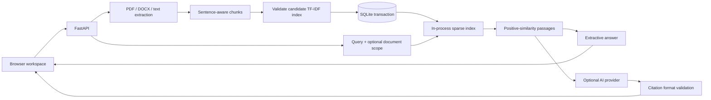

# Engineering notes

DocumentAnalyser is a single-process document research application. The baseline uses lexical retrieval so it runs without a model download, vector service, or paid API. Optional generation sits behind the same evidence retrieval path.

## Request flow

## Decisions and tradeoffs

| Decision                                         | Why                                                                         | Cost / boundary                                                                      |
| ------------------------------------------------ | --------------------------------------------------------------------------- | ------------------------------------------------------------------------------------ |
| TF-IDF with unigrams and bigrams                 | Small, inspectable baseline with no external embedding service              | Lexical overlap misses synonyms and semantic paraphrases                             |
| SQLite for document text, metadata, and chunks   | Transactional updates and restart recovery without another service          | Store plaintext on an access-controlled disk; not a tenant isolation layer           |
| Rebuild the sparse index after mutations         | Keeps document deletion and replacement straightforward                     | Write time grows with corpus size; unsuitable for large document collections         |
| Validate before commit                           | Invalid uploads cannot replace a valid document or corrupt the active index | Temporarily holds old and candidate indexes in memory                                |
| One worker and one instance                      | Maintains agreement between the process-local search cache and SQLite       | Horizontal scaling requires cache invalidation or a shared retrieval service         |
| Ignore zero-similarity results                   | Avoids presenting completely unrelated passages as evidence                 | Positive lexical overlap can still be irrelevant; not a semantic abstention detector |
| One filename per document                        | Re-upload is an explicit replacement, not accidental duplication            | Different files with the same name replace one another                               |
| In-memory browser session                        | Questions and answer history do not go to browser local storage             | Reloading loses session history; export it before leaving                            |
| Server-rendered static assets, no JS build chain | Small deployment and no frontend runtime dependencies                       | Larger UI changes may eventually benefit from components                             |

## Data and mutation consistency

The schema has a `documents` table keyed by filename and a `chunks` table with auto-incrementing identifiers and cascading deletion. Search reads a sparse matrix aligned with an in-memory list of chunks.

A reentrant lock serializes mutations and protects reads within one process. Add and replacement first build a candidate vectorizer. Only after successful validation does a SQLite transaction replace the document and insert its chunks. The active cache is replaced after commit. Deletion follows the same pattern. Startup reconstructs the index from the database. Tests cover replacement failure, concurrent uploads, identifier uniqueness, deletion, reset, and closing/reopening a real database.

The lock does not coordinate independent application processes. Run a single worker against one database. A mounted persistent disk is needed to retain data across hosting instance replacement; a local SQLite file alone cannot make ephemeral hosting durable.

## Retrieval and answer behavior

The query is transformed with the fitted vectorizer. Cosine similarity ranks chunks, an optional filename filters candidates, and only positive scores are retained. Stable identifiers break score ties. Extractive mode scores sentences against query keywords and returns at most three unique sentences with inline source references.

If no candidate has lexical overlap, the application says that matching evidence was not found. It does not call the AI provider in that case. Generated answers must be nonempty and include in-range citation numbers; otherwise the application falls back to extraction. This checks reference format, not factual support or entailment. A valid citation does not guarantee a generated claim is true.

Every question is independent. The UI stores a research session for reviewing and exporting answers; previous turns are not sent as conversational memory.

## Validation strategy

- Unit tests: chunking boundaries, invalid overlap, persistence, replacement, concurrent mutation, scoped retrieval, and absence of zero-score sources.
- API tests: PDF/DOCX/TXT upload, partial batch success, malformed documents, upload limits, input bounds, citations, removal, reset, and provider fallback.
- Provider adapter tests: mocked responses for both adapters, timeout configuration, and invalid citations. Live providers are not required by CI.
- Real browser smoke test: desktop and mobile, sample workflow, citations, export, repeated uploads, filename HTML escaping, search scope, confirmations, and reload.
- Retrieval smoke evaluation: 4 synthetic documents, 12 answerable questions, and 3 zero-overlap queries. This is deliberately small; it detects regressions, not real-world quality.

## Boundaries before a public product

There is no authentication or per-user library. Anyone who can reach the API can read indexed passages, upload documents, and delete the shared library. Do not expose sensitive documents on a public demo. Restrict access or implement authenticated tenant ownership first.

The API caps a batch at 10 files, each 10 MB, and questions at 2,000 characters. These are file-size limits, not complete archive-expansion, parser-time, request-body, or abuse protection. Add reverse-proxy limits, parser isolation/timeouts, rate limits, and quotas for untrusted public traffic.

PDF OCR, encrypted-document workflows, backups, migrations across schema versions, distributed indexing, and semantic relevance thresholds are not implemented. Optional providers receive retrieved text and questions; configure them only for content you may share.

## A useful next experiment

Collect a representative document set and label relevant passages for exact-match questions, paraphrases, ambiguous questions, and plausible-but-unanswerable questions. Compare TF-IDF with a dense or hybrid retriever using Recall@k and MRR, and evaluate answer faithfulness separately. Choose a replacement based on those results, including latency, memory, and failure cases.
